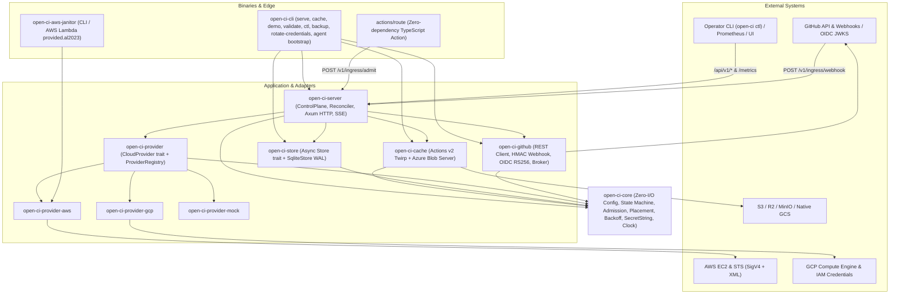
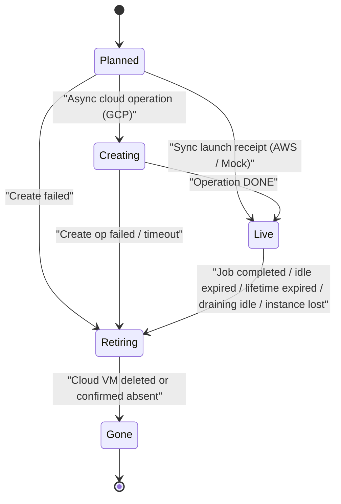

# Architecture & HTTP API

`open-ci` is a modular Rust workspace structured around strict hexagonal (ports-and-adapters) boundaries. Pure domain logic lives in `open-ci-core` with zero network, filesystem, or async runtime dependencies; persistence, cloud APIs, GitHub integration, HTTP ingress, caching, and expiry enforcement live in dedicated adapter crates.

---

## Hexagonal System Diagram



---

## Crate Responsibilities (11 Workspace Crates)

Workspace-wide lints in `Cargo.toml` enforce `unsafe_code = "forbid"`, `clippy::unwrap_used = "deny"`, `clippy::expect_used = "deny"`, `clippy::panic = "deny"`, `clippy::todo = "deny"`, `clippy::unimplemented = "deny"`, and `clippy::pedantic = "warn"`.

| Crate | Role | Key Types & Guarantees |
| --- | --- | --- |
| `open-ci-core` | Pure zero-I/O domain model | `OpenCiConfig` (`#[serde(deny_unknown_fields)]`), `GitHubScope`, `AdmissionMode`, `evaluate_admission`, `evaluate_webhook_admission`, `WorkerPhase` state machine, `evaluate_retirement`, `plan_scale_up`, `select_placement`, `SecretString`, `Clock` / `ManualClock`. Verified with `proptest` in `tests/invariants.rs`. |
| `open-ci-store` | Durable async state storage | `Store` trait and `SqliteStore` using `tokio::task::spawn_blocking`, WAL mode, `fs2` exclusive lockfile fencing, `0o600` pre-creation, normalized migrations, and consistent online backups. |
| `open-ci-provider` | Cloud provider port | `CloudProvider` trait (`create_instance`, `get_operation`, `delete_instance`, `list_instances`, `list_orphan_disks`, `delete_disk`, `health_check`), `InstanceSpec`, `ProviderError`, `ProviderRegistry`. |
| `open-ci-provider-aws` | Native AWS EC2 & STS adapter | Pure-Rust SigV4 signing (`sigv4.rs`), EC2 Query API params (`params.rs`), XML response parsing (`xml.rs`), Spot & On-Demand launch, IMDSv2 enforcement, `AwsCredentialChain` (`Env` → `IMDSv2` → optional STS `AssumeRole` with `ExternalId` or GCP `AssumeRoleWithWebIdentity`). |
| `open-ci-provider-gcp` | Native GCP Compute Engine adapter | Direct Compute Engine REST JSON client, Spot & On-Demand VMs, `maxRunDuration` + `instanceTerminationAction: DELETE`, `serviceAccounts: []`, Shielded VM config, `FileTokenSource` / `MetadataTokenSource` / `ImpersonatedTokenSource`. |
| `open-ci-provider-mock` | Deterministic test & demo provider | In-memory fault-injecting `MockProvider` supporting quota/stockout simulation, used in integration tests and `open-ci demo`. |
| `open-ci-github` | GitHub integration & security | Bounded-pagination REST client supporting repo-level and org-level JIT registration (`runner_group_id`), constant-time HMAC-SHA256 webhook verification, RS256 OIDC JWT verifier with lock-free singleflight JWKS refresh, and privilege-separated `rotate_credentials` broker. |
| `open-ci-server` | Control plane & HTTP server | Non-blocking `ControlPlane`, background reconciler (`scale_up`, `worker_lifecycle`, `orphans`), single-use HMAC bootstrap handler, public machine ingress, bearer-authenticated Operator API, SSE broadcast stream, and Prometheus metrics. |
| `open-ci-cache` | Native Actions v2 cache server | Axum server implementing GitHub Actions Cache v2 Twirp RPCs and Azure-compatible single-shot/block blob endpoints, runtime-token authorization with ref-scoped immutable entries, signed capability URLs, a `SQLite` index with retention, streaming `local`/`s3`/`gcs` `BlobStore` backends, and results-service passthrough. |
| `open-ci-aws-janitor` | Independent AWS expiry guard | Standalone Rust CLI and AWS Lambda (`provided.al2023` custom runtime loop) sweeping expired `open-ci-managed=true` EC2 instances and detached EBS volumes with per-resource error isolation and fail-closed tag parsing. |
| `open-ci-cli` | Thin CLI & worker agent binary | Subcommands: `serve`, `cache`, `demo`, `validate`, `ctl`, `backup`, `rotate-credentials`, `agent bootstrap`. |

---

## Non-Blocking Concurrency Model

`open-ci-server` is designed so slow cloud API calls, disk fsyncs, or JWKS refreshes never stall unrelated HTTP requests or reconciliation:

1. **No global controller mutex.** `ControlPlane` holds shared `Arc` handles (`store`, `providers`, `github`, `oidc`, `clock`, `secrets`, `events`). Read endpoints (`/api/v1/*`, `/healthz`, `/readyz`, `/metrics`) and worker bootstrap never contend on a global lock.
2. **Fine-grained admission serialization.** Only run admission acquires `admission_tx: Arc<Mutex<()>>`, and provider health checks run *before* acquiring that lock. This guarantees atomic, race-free capacity envelope checks across concurrent workflow runs without blocking reconciler cloud calls.
3. **Async-safe SQLite.** Every `rusqlite` call in `SqliteStore` runs inside `tokio::task::spawn_blocking` guarded by a synchronous `std::sync::Mutex<Connection>`, keeping Tokio worker threads free from disk I/O and WAL checkpoints.
4. **Lock-free JWKS reads with singleflight refresh.** `OidcVerifier` serves cached keys under a `tokio::sync::RwLock` and coalesces concurrent JWKS refreshes behind a dedicated `refresh_lock` with a 30-second forced-refresh cooldown and 64 KiB response cap.
5. **Reconciler & graceful shutdown.** `open-ci serve` spawns a background reconciler loop (`server.tick_seconds`, default 5s) paired with Axum via a shared `tokio_util::sync::CancellationToken`. On `SIGINT`/`SIGTERM`, HTTP draining and the background reconciler stop cleanly.
6. **Live event fan-out.** State transitions emit `ControlEvent` items onto a 512-slot `tokio::sync::broadcast` channel streamed to operators over `GET /api/v1/events` (SSE with 15s keepalive).

---

## SQLite Persistence, Fencing & Online Backups

`open-ci-store` persists all control-plane state in a normalized SQLite database configured with:

```sql
PRAGMA journal_mode = WAL;
PRAGMA synchronous = FULL;
PRAGMA foreign_keys = ON;
PRAGMA busy_timeout = 5000;
```

- **Tables:** `schema_migrations`, `control_state` (singleton row `id = 1`), `pool_state` (routing cursor & last discovery timestamp), `admissions` (unique on `(repository, run_id, run_attempt)`), `workers` (unique `request_id`, monotonic phase, `bootstrap_used` flag), `jobs`, `worker_usage`, `placement_backoffs` (primary key `(provider, region, family)`), and `audit_log`.
- **Single-writer fencing:** Opening `SqliteStore` acquires an exclusive `fs2` OS lock on `<database_path>.lock`, preventing two `open-ci serve` processes from writing the same database simultaneously.
- **No permission TOCTOU:** The database file, lockfile, `-wal`, and `-shm` sidecars are pre-created and enforced with `0o600` permissions on Unix.
- **Consistent online backups:** `open-ci backup --config ... --output ...` opens the live database read-only (`SQLITE_OPEN_READ_ONLY`) without colliding with the writer lockfile, runs SQLite's Online Backup API (`128` pages per step), writes to a `0o600` temporary file, and atomically renames it into place.
- **Idempotent launch intent:** Before calling a cloud provider's create API, the reconciler persists a `Planned` worker row with a UUID `request_id` (passed as AWS `ClientToken` / tracked across restarts), so crashes mid-launch cannot create unaccounted workers.

---

## Multi-Cloud Placement, Backoff & Worker Lifecycle

Each pool defines one or more `[[pools.<id>.placements]]` across GCP and/or AWS regions, zones, machine types, and Spot (`spot = true`) vs. On-Demand (`spot = false`) pricing.

### Automatic Quota & Stockout Backoff

When a cloud launch fails, provider errors are classified deterministically:
- `ProviderError::QuotaExceeded` → **300-second** regional `(provider, region, family)` backoff.
- `ProviderError::CapacityUnavailable` (Spot stockout / `InsufficientInstanceCapacity` / `SpotMaxPriceTooLow` / `Unsupported` instance type in AZ / `ZONE_RESOURCE_POOL_EXHAUSTED`) → **90-second** backoff.
- `ProviderError::RateLimited` → `retry_after_seconds` backoff (default **30s**).

The next reconciler tick immediately spills demand onto healthy regions, families, or the secondary cloud.

### Monotonic Worker Phases



EC2 is eventually consistent: `DescribeInstances` can report `InvalidInstanceID.NotFound` for an instance `RunInstances` just created. A `Live` worker the provider cannot list is treated as lost immediately once bootstrapped, and otherwise only after `LAUNCH_VISIBILITY_GRACE_SECONDS` (90s) from creation.

---

## Exact HTTP API Surface

### Public Ingress (`open-ci-server`)

Expose **only** these 6 routes through your TLS reverse proxy (`deploy/caddy/Caddyfile.example`). Global request body limit is 1 MiB (512 bytes for `/usage`).

| Method | Path | Auth | Description |
| --- | --- | --- | --- |
| `GET` | `/healthz` | None | Liveness probe returning `200 OK` (`ok`). |
| `GET` | `/readyz` | None | Readiness probe verifying live SQLite connectivity (`{"status":"ready"}`). |
| `POST` | `/v1/ingress/webhook` | `X-Hub-Signature-256` (constant-time HMAC-SHA256) | GitHub `workflow_job` webhook ingress. Records job hints in `oidc` mode; auto-admits queued jobs in `webhook`/`hybrid` mode. |
| `POST` | `/v1/ingress/admit` | `Authorization: Bearer <GitHub OIDC JWT>` | Verifies RS256 OIDC JWT claims + workflow pinning and returns an idempotent `AdmissionDecision` (`200`), or `403` when `admission.mode = "webhook"`. |
| `POST` | `/v1/workers/{name}/bootstrap` | `Authorization: Bearer <bootstrap HMAC>` | Atomically burns single-use bootstrap capability (`bootstrap_used = 0 -> 1`) and returns ephemeral GitHub JIT config with `Cache-Control: no-store`. |
| `POST` | `/v1/workers/{name}/usage` | `Authorization: Bearer <usage HMAC>` | Records bounded Linux NIC `rx_bytes`/`tx_bytes` telemetry (512-byte body cap, valid only within worker lifetime + 120s). |

### Operator API (`open-ci-server`)

Keep bound to loopback (`127.0.0.1:8080`) or private VPN and block on the public reverse proxy. Requires `Authorization: Bearer <OPEN_CI_OPERATOR_TOKEN_FILE>` verified in constant time (returns `403` if unset).

| Method | Path | Description |
| --- | --- | --- |
| `GET` | `/api/v1/overview` | Scope, admission mode, durable control mode, capacity envelope & reserved headroom, worker counts by phase/provider, active backoffs. |
| `GET` | `/api/v1/pools` | Configured pools, labels, architecture, sizing, placement counts, and active worker counts. |
| `GET` | `/api/v1/workers` | Active and historical workers (`?pool_id=<id>` optional filter). |
| `GET` | `/api/v1/jobs` | Observed GitHub jobs and routing status (`?pool_id=<id>` optional filter). |
| `GET` | `/api/v1/admissions` | Recent admission records (`?limit=<n>`, default 100, max 500). |
| `GET` | `/api/v1/backoffs` | Currently active regional quota/capacity/rate-limit backoffs. |
| `GET` | `/api/v1/audit` | Durable operator mutation audit log (`?limit=<n>`, default 100, max 500). |
| `POST` | `/api/v1/control/mode` | Transition control mode (`active`, `fallback-only`, `draining`, `paused`) with `actor` and `reason` (max 256 bytes each). |
| `POST` | `/api/v1/reconcile` | Trigger one immediate reconciliation pass and return `ReconcileSummary`. |
| `GET` | `/api/v1/events` | Server-Sent Events (`text/event-stream`) streaming live `control_event` JSON messages with 15s keepalive. |
| `GET` | `/metrics` | Prometheus text exposition (`open_ci_workers_total`, `open_ci_capacity_reserved_*`, `open_ci_capacity_limit_*`, `open_ci_held_admissions`, `open_ci_active_backoffs`). |

---

## CLI Subcommands & Key Environment Variables

| Command | Purpose |
| --- | --- |
| `open-ci serve --config <path>` | Start the control plane HTTP server and background reconciler. |
| `open-ci cache --config <path>` | Start the GitHub Actions v2 transparent cache server. |
| `open-ci demo --listen <addr>` | Launch a zero-cloud local sandbox backed by `MockProvider`. |
| `open-ci validate --config <path>` | Validate `open-ci.toml` offline and emit capacity bounds as JSON. |
| `open-ci ctl [--url ...] [--token ...] <status\|set-mode\|reconcile>` | Operate a running control plane over `/api/v1/*`. |
| `open-ci backup --config <path> --output <path>` | Take a consistent online SQLite snapshot without stopping `open-ci serve`. |
| `open-ci rotate-credentials --broker-config <path>` | Atomically rotate GitHub App installation tokens (and optional GCP metadata tokens). |
| `open-ci agent bootstrap [--runner-dir /opt/actions-runner]` | Executed inside ephemeral VMs: scrubs user-data, fetches JIT config, configures NVMe/BuildKit/cache env, runs official runner as non-root, reports NIC bytes, and powers off. |
