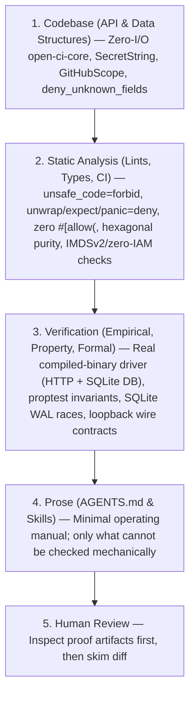

# Engineering Principles & 7-Gate Proof Ladder

`open-ci` invests verification effort directly into the repository's deterministic environment — strict types, compiler lints, hexagonal purity checks, property tests, and real compiled-binary HTTP + SQLite verification — so humans and coding agents alike ship fast without drift.

---

## The Pyramid of Trust

Every engineering rule is pushed as high up the deterministic stack as possible. Higher layers cost zero ongoing tokens and cannot drift; lower layers are reserved for judgment calls machines cannot make.



1. **Codebase (Level 1 — Strongest Lever):** Good API design, clean crate boundaries, and strict types make invalid states impossible to compile. `open-ci-core` has zero I/O crates in `Cargo.toml`, `SecretString` redacts secrets in `Debug`, `GitHubScope` separates repo vs org API routing, and `#[serde(deny_unknown_fields)]` rejects config typos at parse time.
2. **Static Analysis (Level 2 — Deterministic, Zero Ongoing Cost):** Workspace Cargo lints (`unsafe_code = "forbid"`, `clippy::unwrap_used = "deny"`, `expect_used = "deny"`, `panic = "deny"`, `pedantic = "warn"`), a hard ban on `#[allow(`, `cargo tree` dependency-graph checks, and shell/Terraform/policy gates catch shortcuts before tests even run.
3. **Verification (Level 3 — Empirical & Property Proofs):** Instead of relying on brittle mocks, every PR executes the real system and hammers its state space:
   - Live compiled-binary driver (`.agents/skills/verify-open-ci/scripts/drive.sh`) asserting **Action → HTTP/Runtime State → SQLite DB Side Effects**.
   - Randomized property tests (`proptest`) in `crates/open-ci-core/tests/invariants.rs`.
   - Real on-disk SQLite WAL concurrency and online backup races (`crates/open-ci-store`).
   - Real loopback TCP/Axum wire-contract tests validating SigV4, XML, OIDC JWKS, Twirp v2, and HMAC bytes (zero `#[ignore]`).

---

## The 7-Gate Executable Proof Ladder (`./scripts/verify.sh`)

Every change must exit `0` across all 7 gates in `./scripts/verify.sh` (use `./scripts/verify.sh --fast` during inner-loop iteration to skip Gate 4):

```bash
./scripts/verify.sh
```

| Gate | What It Proves |
| --- | --- |
| **1. Static, Lint & Hexagonal Purity** | `cargo fmt --all -- --check`, `cargo clippy --workspace --all-targets -- -D warnings`, zero `#[allow(` attributes in `crates/`, and `cargo tree -p open-ci-core` confirms zero `tokio`/`reqwest`/`rusqlite`/`axum`/`hyper` dependencies. |
| **2. Domain Invariants, Storage, Wire Contracts & E2E** | `cargo test --workspace` — runs `proptest` domain invariants (`open-ci-core`), real SQLite durability/lock/backup races (`open-ci-store`), loopback AWS/GCP/identity contract tests, cache Twirp + storage tests (`open-ci-cache`), janitor fault-isolation tests, and control-plane lifecycle E2E tests (`open-ci-server`) with zero `#[ignore]`d tests. |
| **3. Offline Config Validation** | `cargo run --quiet --bin open-ci -- validate --config config/open-ci.example.toml` — proves the shipped example config parses cleanly and passes all capacity and trust invariants. |
| **4. Real Compiled-Binary Runtime Proof** | Invokes `.agents/skills/verify-open-ci/scripts/drive.sh`: builds `target/debug/open-ci`, launches `open-ci demo` on an isolated ephemeral loopback port and temp SQLite directory, polls `/healthz` + `/readyz`, drives unauthenticated `401`, authenticated `/api/v1/overview`, Prometheus `/metrics`, live `open-ci ctl set-mode draining`, `/api/v1/audit`, and direct SQLite DB verification (`control_state`, `audit_log`, `PRAGMA integrity_check`), then cleans up. |
| **5. TypeScript Routing Action** | `node --test actions/route/test/route.test.ts` — proves fail-closed fallback on reruns, timeouts, 4xx responses, and malformed payloads. |
| **6. IaC, Packer & Security Policy Invariants** | `terraform fmt -check -recursive infra/terraform`, `bash -n` on `verify.sh`, `drive.sh`, and Packer scripts (`shellcheck` when installed), plus static policy checks enforcing IMDSv2 (`http_tokens = "required"` / `MetadataOptions.HttpTokens = required`) and zero-IAM GCP runners (`"serviceAccounts": []`). |
| **7. Route & Doc Parity** | Extracts every registered Axum route from `crates/open-ci-server/src/http/*.rs` and verifies verbatim presence in `docs/architecture.md`, preventing silent drift between code and docs. |

---

## Contributing to `open-ci`

Contributions are welcome under the **Apache-2.0** license!

1. Fork and clone [`katchlabs/open-ci`](https://github.com/katchlabs/open-ci).
2. Ensure you have Rust 1.89+ (`rust-toolchain.toml`) and Node 22+ installed.
3. Follow Conventional Commits (`feat:`, `fix:`, `docs:`, `refactor:`, `test:`).
4. Run `./scripts/verify.sh` locally and include your empirical proof output in the PR description.
5. Keep inline comments minimal — encode invariants in types, lints, or tests rather than prose comments.
