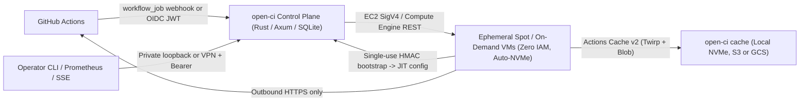

# Overview & 60-Second Local Demo

`open-ci` is a single Rust binary for running **self-hosted ephemeral GitHub Actions runners on Spot and On-Demand AWS & GCP VMs**, with built-in transparent Actions v2 caching, auto-NVMe scratch storage, and zero cloud IAM attached to worker VMs.



## Core Capabilities

- **Drop-in or fail-closed routing.** Use `admission.mode = "webhook"` for zero workflow edits (`runs-on: open-ci-linux-x64`), `admission.mode = "oidc"` with [`katchlabs/open-ci/actions/route`](https://github.com/katchlabs/open-ci/tree/main/actions/route) to fail closed to `ubuntu-latest` on outage, drain, or capacity exhaustion, or `"hybrid"` for both.
- **Org-wide and multi-repo native.** Target a single `owner/repo` or an entire GitHub organization with `allowed_repositories` allowlists (e.g. `["my-org/*"]`) and `runner_group_id` JIT registration.
- **Multi-cloud without SDK bloat.** Pure-Rust AWS EC2 + STS SigV4/XML and GCP Compute Engine REST adapters — no `aws` or `gcloud` CLI subprocesses, with native BYOC identity (`IMDSv2` + STS `AssumeRole` with `ExternalId`; GCE metadata + IAM service account impersonation; keyless GCP→AWS web identity federation).
- **Fast builds out of the box.** Built-in GitHub Actions v2 transparent cache (`open-ci cache`) backed by local NVMe, native S3/R2/MinIO, or native GCS, plus boot-time auto-detection and `ext4`/RAID0 mounting of local ephemeral NVMe SSDs for Docker layers, `RUNNER_WORKDIR`, and `TMPDIR`.
- **Zero-IAM, hard-bounded runners.** Workers boot with zero cloud IAM (`serviceAccounts: []` on GCP; no instance profile + IMDSv2 required on AWS), zero inbound ports, single-use atomic HMAC bootstrap tokens, and triple-layer expiry.
- **Strict Rust safety.** Compiles to static-friendly `x86_64` and `aarch64` Linux binaries and multi-arch GHCR containers under `unsafe_code = "forbid"`, `clippy::unwrap_used = "deny"`, `expect_used = "deny"`, and `panic = "deny"`.

---

## 60-Second Local Quickstart (Zero Cloud Accounts)

Run the full control plane locally against `MockProvider` to inspect the Operator API, SSE event stream, and Prometheus metrics before touching AWS or GCP.

### 1. Launch `open-ci demo`

```bash
# Option A: Multi-arch container (linux/amd64, linux/arm64)
docker run --rm -p 8080:8080 ghcr.io/katchlabs/open-ci:latest demo --listen 0.0.0.0:8080

# Option B: Prebuilt Linux release binary (x86_64 or aarch64)
curl -fsSL https://github.com/katchlabs/open-ci/releases/latest/download/open-ci-x86_64-unknown-linux-gnu.tar.gz \
  | tar -xz -C /usr/local/bin
open-ci demo --listen 127.0.0.1:8080

# Option C: From source (Rust 1.89+)
cargo run --bin open-ci -- demo --listen 127.0.0.1:8080
```

### 2. Query the Live Control Plane

In a second terminal:

```bash
export OPEN_CI_URL="http://127.0.0.1:8080"
export OPEN_CI_OPERATOR_TOKEN="demo-operator-token-000000000000"

open-ci ctl status
```

Example output:

```json
{
  "active_backoffs": 0,
  "admission_mode": "hybrid",
  "capacity": {
    "held_admissions": 0,
    "limit": {
      "disk_gb": 300,
      "instances": 8,
      "vcpu": 16
    },
    "reserved": {
      "disk_gb": 20,
      "instances": 1,
      "vcpu": 2
    }
  },
  "control": {
    "mode": "active",
    "reason": "initial",
    "updated_at": 0,
    "updated_by": "system"
  },
  "organization": null,
  "pools_configured": 1,
  "repository": "example/repo",
  "scope": "example/repo",
  "timestamp": 1763916000,
  "workers": {
    "active": 0,
    "by_phase": {},
    "by_provider": {}
  }
}
```

### 3. Inspect Metrics, SSE Events & Mode Transitions

```bash
curl -sS -H "Authorization: Bearer $OPEN_CI_OPERATOR_TOKEN" "$OPEN_CI_URL/metrics"
curl -sS -N -H "Authorization: Bearer $OPEN_CI_OPERATOR_TOKEN" "$OPEN_CI_URL/api/v1/events"
open-ci ctl set-mode draining --reason "maintenance"
open-ci ctl set-mode active --reason "resume"
```

Validate any `open-ci.toml` file offline before deploying:

```bash
open-ci validate --config config/open-ci.example.toml
```

---

## Verified 2026 Cost Comparison

Because `open-ci` runs directly inside your AWS or GCP account, you pay raw Spot compute rates plus a flat `~$15/mo` controller VM (`e2-small` or `t4g.small`) with zero per-minute SaaS markup:

| Profile | Workload | GitHub Actions | Managed Runner SaaS | `open-ci` (Your Cloud) | Annual Savings |
| --- | --- | --- | --- | --- | --- |
| **Startup (10 devs)** | 40k 4-vCPU min/mo | $480/mo | $320/mo | **~$75/mo** | **$4,860/yr (84%)** |
| **Growth Team (40 devs)** | 200k 4-vCPU min/mo | $2,400/mo | $1,600/mo | **~$315/mo** | **$25,020/yr (87%)** |
| **Monorepo Scale (150 devs)** | 500k 8-vCPU min/mo | $11,000/mo | $8,000/mo | **~$1,450/mo** | **$114,600/yr (87%)** |

---

## Workspace & Infrastructure Map

| Path | Responsibility |
| --- | --- |
| `crates/open-ci-core` | Zero-I/O domain core: typed TOML config + validation, worker state machine, admission capacity math, placement selection, regional quota backoff, `SecretString`, `Clock`. |
| `crates/open-ci-store` | Async `Store` trait and non-blocking normalized `SQLite` backend (`spawn_blocking`, WAL, `0o600` pre-creation, `fs2` exclusive lockfile, online backup snapshots). |
| `crates/open-ci-provider` | Cloud-agnostic `CloudProvider` trait, typed `ProviderError`, `InstanceSpec`, and `ProviderRegistry`. |
| `crates/open-ci-provider-aws` | Pure-Rust AWS EC2 + STS adapter (SigV4 signing, XML parsing, Spot/On-Demand, IMDSv2, cross-account `AssumeRole` with `ExternalId`). |
| `crates/open-ci-provider-gcp` | Native Rust GCP Compute Engine REST adapter (Spot/On-Demand, `maxRunDuration`, `serviceAccounts: []`, GCE metadata & IAM impersonation). |
| `crates/open-ci-provider-mock` | Deterministic fault-injecting provider for tests and `open-ci demo`. |
| `crates/open-ci-github` | Typed GitHub REST client (bounded pagination, repo & org JIT registration), constant-time HMAC webhook verifier, RS256 OIDC JWT verifier, privilege-separated credential broker. |
| `crates/open-ci-server` | Non-blocking `ControlPlane`, background reconciler, public machine ingress, authenticated Operator API, SSE stream, and Prometheus `/metrics`. |
| `crates/open-ci-cache` | Native GitHub Actions v2 transparent cache server (Twirp RPCs + Azure block blob protocol): runtime-token auth with ref-scoped entries, `SQLite` index with retention, streaming `local`/`s3`/`gcs` blob stores, and results-service passthrough. |
| `crates/open-ci-aws-janitor` | Standalone Rust CLI and AWS Lambda (`provided.al2023`) expiry guard that terminates leaked EC2 instances and detached EBS volumes with per-resource fault isolation. |
| `crates/open-ci-cli` | Unified CLI binary (`serve`, `cache`, `demo`, `validate`, `ctl`, `backup`, `rotate-credentials`, `agent bootstrap`). |
| `actions/route` | Zero-dependency TypeScript (`node24`) GitHub Action for fail-closed OIDC admission routing. |
| `infra/terraform` | Turnkey modules (`gcp-foundation`, `gcp-controller`, `aws-foundation`, `aws-controller`) and examples (`gcp-quickstart`, `aws-controller`, `multi-cloud`). |
| `infra/packer` | Unified GCP + AWS Packer template (`ubuntu-runner.pkr.hcl`) for `x64`/`arm64` Ubuntu 24.04 runners with boot-time auto-NVMe (`setup-nvme.sh`), Docker BuildKit, and sysctl tuning. |
| `deploy/` | Hardened systemd units (`open-ci.service`, `open-ci-cache.service`, `open-ci-credentials.timer`, `open-ci-backup.timer`), Caddy reverse proxy template, and multi-stage Dockerfile. |

## Next Steps

- Ready to deploy in AWS, GCP, or both clouds? Continue to the [Deployment Quickstart](/docs/quickstart).
- Want to tune pools, admission modes, and capacity guardrails? Read the [Configuration Reference](/docs/configuration).
- Evaluating security for untrusted pull requests? Review the [Security & Threat Model](/docs/security).
