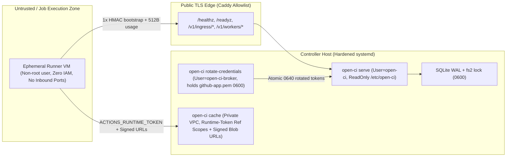

# Security & Threat Model

`open-ci` executes untrusted or semi-trusted CI workloads inside ephemeral cloud VMs. Its security model assumes **a job running on a worker VM is potentially hostile** and isolates cloud credentials, GitHub App keys, cache tenants, and controller state accordingly.

---

## Trust Boundaries & Defense-in-Depth Matrix

| Threat | Defense Control | Enforcement Point |
| --- | --- | --- |
| Compromised CI job pivots to cloud APIs | Zero IAM on runner VMs (`serviceAccounts: []` on GCP; no instance profile + IMDSv2 required on AWS) | `open-ci-provider-gcp/src/dto.rs`, `open-ci-provider-aws/src/params.rs`, Terraform modules |
| Compromised CI job reads cloud-init bootstrap secret | `open-ci agent bootstrap` deletes cloud-init user-data files and burns single-use token before spawning runner as non-root `runner` | `open-ci-cli/src/agent.rs`, `open-ci-server/src/bootstrap.rs` |
| Replay or racing of bootstrap token to mint extra JIT runners | Atomic SQLite transition `UPDATE ... WHERE bootstrap_used = 0` executed **before** calling GitHub's JIT API; `Cache-Control: no-store` | `open-ci-store/src/sqlite/workers.rs`, `open-ci-server/src/bootstrap.rs` |
| Compromised control plane steals GitHub App private key | Privilege-separated `open-ci-broker` user owns `github-app.pem` (`0o600`, symlink rejected); `open-ci` only reads rotated short-lived tokens (`0o640`) | `open-ci-github/src/broker.rs`, `deploy/systemd/open-ci-credentials.service` |
| Forged webhook or OIDC token triggers unauthorized runner spend | Constant-time HMAC-SHA256 webhook check; RS256 OIDC JWT verification pinning `aud`, `iss`, `owner_id`, `repository_id`/allowlist, `sub`, and 40-char workflow SHA | `open-ci-github/src/webhook.rs`, `open-ci-github/src/oidc.rs` |
| Zombie VMs or leaked EBS volumes burn cloud budget | Triple-layer hard expiry: reconciler TTL, cloud-native `maxRunDuration` / fault-isolated `open-ci-aws-janitor`, and guest `systemctl poweroff` | `open-ci-core/src/reconcile.rs`, `open-ci-provider-gcp`, `open-ci-aws-janitor`, `open-ci-cli/src/agent.rs` |
| Cross-repo or cross-branch cache poisoning, path traversal | Verified Actions runtime tokens with a repository-ID allowlist, immutable entries keyed by Git ref scope (PRs never write the base branch), per-operation signed blob URLs, validated `BlobId`/`BlockId` newtypes, enforced `Content-Length` | `open-ci-github/src/runtime_token.rs`, `open-ci-cache/src/http/`, `open-ci-cache/src/ids.rs` |
| Cross-account BYOC confused deputy | AWS STS `AssumeRole` with `ExternalId`; GCP IAM Credentials API impersonation with strict SA validation | `open-ci-provider-aws/src/credentials/`, `open-ci-provider-gcp/src/auth/` |
| Public exposure of operator controls or metrics | Caddy public allowlist blocks `/api/v1/*` and `/metrics`; constant-time bearer middleware disables API (`403`) if token file is unset | `deploy/caddy/Caddyfile.example`, `open-ci-server/src/http/operator.rs` |
| Secret leakage in structured JSON logs | `SecretString` redacts both `Debug` and `Display` to `[REDACTED]`; clean secret-free `ApiError` responses | `open-ci-core/src/secret.rs`, `open-ci-server/src/http/mod.rs` |

---

## Detailed Security Controls

### 1. Zero-IAM & Network-Isolated Ephemeral Runners

- **GCP Compute Engine (`open-ci-provider-gcp`):** Every VM is created with `"serviceAccounts": []`, `"block-project-ssh-keys": "true"`, Shielded VM (`enableSecureBoot`, `enableVtpm`, `enableIntegrityMonitoring`), `"automaticRestart": false`, `"onHostMaintenance": "TERMINATE"`, and boot disk `"autoDelete": true`. External IPv4 is disabled by default (`external_ipv4 = false`), routing outbound traffic through Cloud NAT.
- **AWS EC2 (`open-ci-provider-aws`):** Every VM is launched without an IAM instance profile, with `MetadataOptions.HttpTokens=required` (IMDSv2 enforced), `MetadataOptions.HttpPutResponseHopLimit=1` (blocks container-to-IMDS access), `InstanceInitiatedShutdownBehavior=terminate`, encrypted root EBS (`BlockDeviceMapping.1.Ebs.Encrypted=true`), and `DeleteOnTermination=true`.
- **Network ingress:** Terraform runner security groups and firewall rules permit zero inbound ports; workers initiate outbound HTTPS only.
- **Non-root execution:** `open-ci agent bootstrap` invokes the official `actions/runner` (`run.sh --jitconfig ...`) via `runuser -u runner` (configurable via `OPEN_CI_RUNNER_USER`), never as `root`.
- **Supply-chain pinning:** `infra/packer/scripts/install-runner.sh` verifies the exact `SHA-256` checksum of the downloaded `actions/runner` archive before extraction and scrubs SSH host keys, `/etc/machine-id`, and cloud-init logs from baked images.

### 2. Single-Use Atomic HMAC Bootstrap & Bounded Telemetry

Each worker receives two distinct HMAC-SHA256 bearer tokens derived from `OPEN_CI_BOOTSTRAP_SECRET_FILE` (minimum 32 bytes):
- `bootstrap:{worker_name}` — valid for `POST /v1/workers/{name}/bootstrap`
- `usage:{worker_name}` — valid for `POST /v1/workers/{name}/usage`

Bootstrap security invariants:
1. `open-ci agent bootstrap` immediately deletes `/var/lib/cloud/instance/user-data.txt` and `user-data.txt.i` on startup before running user jobs.
2. Cloud-init passes the JSON envelope via stdin (`<<'OPEN_CI_EOF'`), eliminating shell interpolation and command injection.
3. On bootstrap request, `ControlPlane::handle_bootstrap` verifies the HMAC in constant time, checks control mode (`allows_new_workers()`), confirms worker phase is `Live`, confirms `now < created_at + idle_seconds`, and **atomically burns `bootstrap_used = 0 -> 1` in SQLite before calling GitHub's non-idempotent JIT registration API**.
4. The JIT config response sets `Cache-Control: no-store`. If GitHub returns an error, the worker transitions to `Retiring` (`bootstrap_failed`).
5. `/v1/workers/{name}/usage` enforces a 512-byte body cap (`DefaultBodyLimit::max(512)`), requires `bootstrap_used = 1`, rejects samples outside `created_at + lifetime_seconds + 120s`, and rejects out-of-range byte counts (`0` or `>= 2^60`).

### 3. Privilege-Separated Credential Broker

The long-lived GitHub App RSA private key (`github-app.pem`) is never readable by `open-ci serve`:
- `open-ci-credentials.service` (triggered every 45 minutes by `open-ci-credentials.timer`) runs `open-ci rotate-credentials` as `User=open-ci-broker` (`Group=open-ci`, `UMask=0027`).
- `open_ci_github::broker::read_private_key` rejects symlinks, non-regular files, and any file with group or world permission bits set (`mode & 0o077 != 0`).
- The broker signs a short-lived RS256 App JWT (`iat = now - 30`, `exp = now + 540`), exchanges it over HTTPS for a GitHub installation token, and writes `/run/open-ci/github-token` atomically via `NamedTempFile` + `sync_all()` + `0o640` permissions.
- `open-ci.service` runs as `User=open-ci` with `ReadOnlyPaths=/etc/open-ci /run/open-ci` and caches the rotated token in memory for 60 seconds.

### 4. OIDC Claim Verification & Workflow SHA Pinning

When `admission.mode` is `"oidc"` or `"hybrid"`, `POST /v1/ingress/admit` enforces strict RS256 JWT validation:
- Rejects tokens > 16 KiB, non-`RS256` algorithms, missing/non-ASCII `kid` headers, expired tokens, or future `nbf` claims (10s leeway).
- Validates `iss` (`github.oidc_issuer`) and `aud` (`github.oidc_trust.audience`).
- Validates `repository` against `GitHubScope`, numeric `repository_owner_id == owner_id`, and numeric `repository_id` (required for single-repo configs).
- Matches `sub` against `subjects` (exact match or `repo:<org-pattern>:<exact-context>` without wildcards in the context suffix).
- Validates workflow identity via either exact 40-character commit SHA pinning in `[github.oidc_trust.workflows]` or allowed repository-local paths in `allowed_workflow_paths`.
- Reruns (`run_attempt > 1`) route to fallback by default (`admission.fallback_on_rerun = true`).

### 5. Triple-Layer Hard VM Expiry

Even if the controller crashes, loses network access, or a workflow hangs indefinitely, VMs cannot run forever:
1. **Layer 1 — Control Plane Reconciler:** `evaluate_retirement` retires workers at `created_at + idle_seconds` (if unbootstrapped) or `created_at + lifetime_seconds` (unconditional hard cap) and deletes the cloud VM + any orphan disks.
2. **Layer 2 — Cloud-Native / Independent Janitor:**
   - **GCP:** `scheduling.maxRunDuration = lifetime_seconds` with `instanceTerminationAction = "DELETE"` terminates and deletes the VM at the Compute Engine control plane.
   - **AWS:** Every instance and EBS volume is tagged `open-ci-managed=true` and `open-ci-expires-at=<unix>`. `open-ci-aws-janitor` runs independently on AWS Lambda (`provided.al2023`) or cron, clamps deadlines to `launch_time + max_ceiling_seconds`, **fails closed** (treats missing or unparseable `open-ci-expires-at` tags as expired), and isolates errors per resource.
3. **Layer 3 — Guest Agent Timeout:** `open-ci agent bootstrap` bounds the child `run.sh` process with `tokio::time::timeout(lifetime_seconds)` (`kill_on_drop(true)`) and executes `systemctl poweroff` on exit (paired with AWS `InstanceInitiatedShutdownBehavior=terminate`).

### 6. BYOC Cross-Account & Cross-Project Identity

- **AWS (`open-ci-provider-aws`):** `AwsCredentialChain` resolves base credentials from environment variables or EC2 IMDSv2, then optionally wraps them with STS `AssumeRole` (`aws.role_arn`) passing `ExternalId` (`aws.external_id`). A controller hosted on GCP can instead set `aws.web_identity_audience`: it requests a Google identity token for that audience from the GCE metadata server and exchanges it via STS `AssumeRoleWithWebIdentity`, pinned in the IAM trust policy to the controller service account's numeric ID — zero AWS access keys exist on the host.
- **GCP (`open-ci-provider-gcp`):** Resolves base tokens from `OPEN_CI_GCP_TOKEN_FILE` or the GCE Metadata Server, then optionally calls the IAM Credentials API (`generateAccessToken`) to impersonate `gcp.impersonate_service_account`.

### 7. Host, Storage & Reverse Proxy Hardening

- **SQLite file permissions:** `SqliteStore::open` pre-creates the database, `.lock`, `-wal`, and `-shm` files with `0o600` permissions before SQLite opens them (eliminating permission TOCTOU).
- **Systemd sandboxing:** `open-ci.service` and `open-ci-cache.service` enable `NoNewPrivileges=true`, `ProtectSystem=strict`, `ProtectHome=true`, `PrivateTmp=true`, `PrivateDevices=true`, `ProtectKernelTunables=true`, `ProtectKernelModules=true`, `ProtectControlGroups=true`, `RestrictRealtime=true`, `RestrictNamespaces=true`, `LockPersonality=true`, and `UMask=0077`.
- **Reverse proxy separation:** `deploy/caddy/Caddyfile.example` allowlists only the 6 public machine ingress paths; `/api/v1/*` and `/metrics` are reachable only over loopback, SSH tunnel, or a private VPN.
